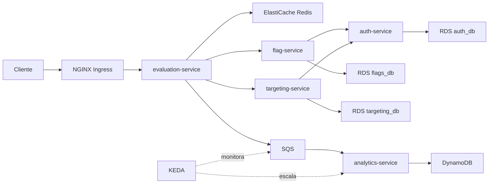

# ToggleMaster - Tech Challenge Fase 2

Projeto de microsserviços com Docker Compose e AWS EKS, desenvolvido por Victor Leonardo.

## Entrega

- Participante: Victor Leonardo · RM rm375744
- Discord: `_vimedina_18014`
- Modalidade: individual
- Vídeo: https://youtu.be/-uGdLy0lFYo
- Repositório: https://github.com/victorrmds/togglemaster-phase2

## Arquitetura



| Serviço | Porta | Responsabilidade |
|---|---:|---|
| auth-service | 8001 | Emissão e validação de chaves de API |
| flag-service | 8002 | Definições de feature flags |
| targeting-service | 8003 | Regras de segmentação |
| evaluation-service | 8004 | Decisão true/false, cache e publicação de eventos |
| analytics-service | 8005 | Consumo de eventos e persistência |

RDS mantém dados relacionais; Redis reduz consultas no caminho de avaliação;
DynamoDB armazena eventos. SQS desacopla avaliação e processamento assíncrono.

## Organização

- `*-service/`: código, Dockerfile e documentação de cada serviço.
- `docker-compose.yml`: cinco aplicações e quatro contêineres de dados.
- `k8s/eks/`: manifestos EKS validados com server dry-run em 01/11/2026.
- `kubernetes/secrets.example.yaml`: somente placeholders; não aplicar diretamente.
- `CREDENTIALS.md`: configuração privada e cuidados de publicação.
- `docs/TESTES.md`: resultados e limites dos testes.
- `docs/DESAFIOS.md`: desafios, ajustes técnicos e aprendizados.

Use somente `k8s/eks` para a configuração de nuvem. Não misture manifestos locais antigos.

## Execução local

Pré-requisitos: Docker Desktop com engine Linux, Docker Compose, AWS CLI e
credenciais com acesso à fila SQS dedicada ao ambiente local.
O ambiente não é totalmente offline: utiliza AWS SQS.

1. Copie os cinco `.env.example` para `.env`, sem sobrescrever configurações existentes.
2. Preencha uma MASTER_KEY privada em auth e configure a mesma fila local em
   evaluation e analytics. Use uma fila diferente da fila do EKS.
3. Inicie os bancos e o cache:

```powershell
docker compose up -d postgres-auth postgres-feature redis dynamodb-local
```

4. Em uma instância nova do DynamoDB Local, crie a tabela:

```powershell
aws dynamodb create-table --table-name ToggleMasterAnalytics --attribute-definitions AttributeName=event_id,AttributeType=S --key-schema AttributeName=event_id,KeyType=HASH --provisioned-throughput ReadCapacityUnits=1,WriteCapacityUnits=1 --endpoint-url http://localhost:8000 --region sa-east-1
```

5. Inicie auth com `docker compose up -d --build auth-service`. Emita uma chave
   usando `POST /admin/keys`, cabeçalho `Authorization: Bearer <MASTER_KEY>` e corpo
   `{"name":"evaluation-service"}`. Faça isso privadamente; não grave a chave em logs.
   Salve a chave retornada em SERVICE_API_KEY no `.env` de evaluation.
6. Inicie o conjunto:

```powershell
docker compose up -d --build
docker compose ps
```

Todos os serviços expõem `/health`. Os SQLs são montados para inicialização dos
volumes PostgreSQL novos; volumes existentes não repetem automaticamente a inicialização.
DynamoDB Local usa memória e perde a tabela ao reiniciar. As senhas padrão do
Compose são apenas para demonstração local. Não use essas senhas em RDS.

## Ambiente EKS

Conta pessoal AWS, região sa-east-1, cluster ToggleMasterEKS, namespace togglemaster.
Infraestrutura: cinco repositórios ECR, três RDS PostgreSQL, ElastiCache Redis,
fila SQS Standard e tabela DynamoDB com chave string `event_id`, em PAY_PER_REQUEST.
Metrics Server, NGINX e KEDA complementam o cluster.

Consulte `k8s/eks/README.md` para dependências e ordem de configuração.
Os manifestos contêm endpoints e ARNs do ambiente demonstrado; adapte-os antes
de utilizar outra conta. Não provisionam a infraestrutura AWS por si só.

```powershell
$eksContext = 'arn:aws:eks:sa-east-1:302795277290:cluster/ToggleMasterEKS'
kubectl --context $eksContext get deployments,services,ingress,hpa -n togglemaster
kubectl --context $eksContext apply --dry-run=server -R -f k8s/eks
```

O dry-run valida sem persistir alterações. A configuração foi aceita pelo cluster;
os cinco ConfigMaps retornaram unchanged. Não é necessário reaplicar para a demonstração.

## Segurança e escalabilidade

Secrets armazenam DATABASE_URL, MASTER_KEY e SERVICE_API_KEY. ConfigMaps contêm
parâmetros não sensíveis. IRSA fornece acesso AWS aos pods sem access keys estáticas.
Base64 não é criptografia; arquivos reais de Secrets e `.env` não são versionados.

- Evaluation: HPA por CPU, alvo 60%, de 1 a 3 réplicas, estabilização de redução 300s.
- Analytics: KEDA por SQS, de 0 a 3 réplicas, alvo 20 mensagens por réplica,
  incluindo in-flight; polling 10s e cooldown 120s.
- A role efetiva de analytics chama-se ToggleMasterAnalyticsPolicy.
- O HPA de analytics é gerado pelo KEDA; não adicionar outro HPA ao mesmo Deployment.

## Resultados e limites

Integração local e EKS verificadas. Evaluation escalou 1 -> 2 -> 3 -> 1;
analytics escalou 0 -> 1 -> 3 -> 1 -> 0. Veja `docs/TESTES.md`.
O Ingress validado expõe `/evaluate` por HTTP. HTTPS é evolução futura.
Health checks são simples e não comprovam saúde de todas as dependências.
Imagens usam latest; fixação por digest é recomendada como evolução.
Analytics não implementa deduplicação: cada processamento gera novo event_id.
Escalar pods para zero não elimina os custos dos nós EKS e dos serviços AWS.
